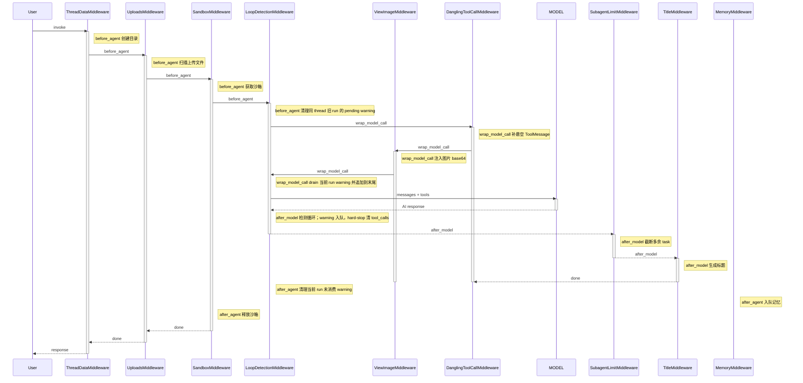
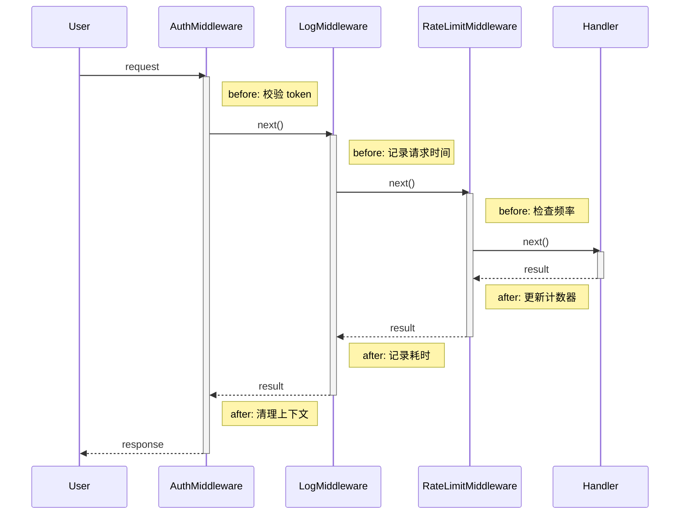
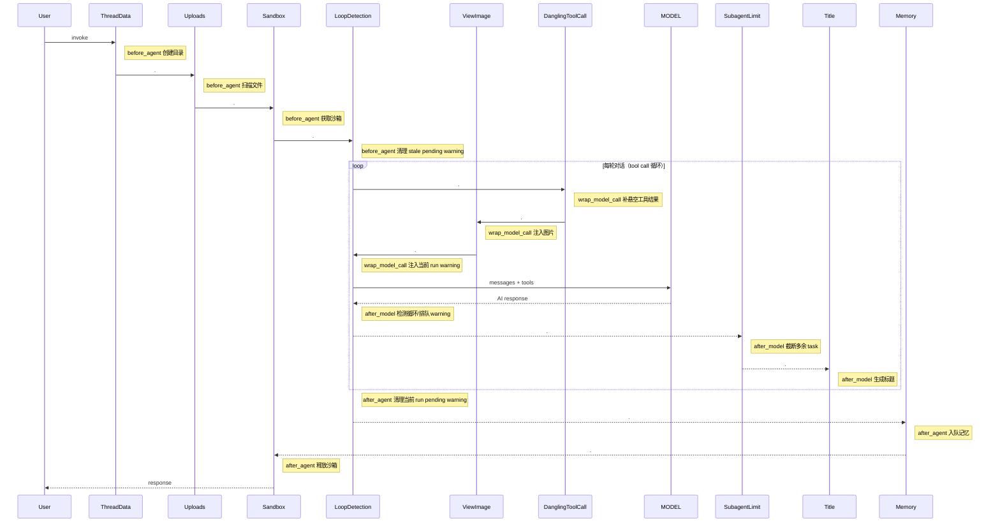

# Middleware 执行流程

## Middleware 列表

Lead agent 的完整 middleware 链由 `packages/harness/deerflow/agents/lead_agent/agent.py` 的
`build_middlewares()` 组装（公共运行时段来自 `build_lead_runtime_middlewares()` /
`_build_runtime_middlewares()`，见
`packages/harness/deerflow/agents/middlewares/tool_error_handling_middleware.py`），
最后经 `compose_with_extensions` 合并扩展贡献。下表为 2026-10-04 核对的实际顺序
（`make_lead_agent` / 嵌入式 `DeerFlowClient` 共用同一链）：

| # | Middleware | 钩子 | 生效条件 |
|--:|-----------|------|----------|
| 1 | InputSanitizationMiddleware | `wrap_model_call` | 常开（最外层包装） |
| 2 | ToolOutputBudgetMiddleware | `wrap_model_call` `wrap_tool_call` | 常开 |
| 3 | ToolResultSanitizationMiddleware | `wrap_tool_call` | 常开 |
| 4 | ThreadDataMiddleware | `before_agent` | 常开 |
| 5 | UploadsMiddleware | `before_agent` | 常开（主 agent；subagent 链不含） |
| 6 | SandboxMiddleware | `before_agent` `after_agent` `wrap_tool_call` | 常开 |
| 7 | DanglingToolCallMiddleware | `wrap_model_call` | 常开（主 agent 与 subagent 共享） |
| 8 | LLMErrorHandlingMiddleware | `wrap_model_call` | 常开 |
| 9 | ToolReceiptMiddleware | `wrap_model_call` `wrap_tool_call` | `verification.receipts_enabled` |
| 10 | GuardrailMiddleware（授权适配） | `wrap_tool_call` | `authorization.enabled` 且解析到 provider |
| 11 | GuardrailMiddleware（显式 guardrails） | `wrap_tool_call` | `guardrails.enabled` 且配置 provider |
| 12 | SandboxAuditMiddleware | `wrap_tool_call` | 常开 |
| 13 | ReadBeforeWriteMiddleware | `wrap_model_call` `wrap_tool_call` | `read_before_write.enabled` |
| 14 | ToolProgressMiddleware | `before_agent` `wrap_model_call` `wrap_tool_call` | `tool_progress.enabled` |
| 15 | ToolErrorHandlingMiddleware | `wrap_tool_call` | 常开 |
| 16 | DynamicContextMiddleware | `before_agent` `wrap_model_call` | 常开 |
| 17 | SkillActivationMiddleware | `wrap_model_call` | 常开 |
| 18 | DeferredToolPromotionAuditMiddleware | `wrap_tool_call` | tool_search 启用且有 deferred 工具 |
| 19 | SkillToolPolicyMiddleware | `wrap_model_call` `wrap_tool_call` | 常开 |
| 20 | DurableContextMiddleware | `before_model` `after_model` `wrap_model_call` | 常开 |
| 21 | SummarizationMiddleware（`DeerFlowSummarizationMiddleware`） | `before_model` | `summarization.enabled` |
| 22 | TodoMiddleware（LangChain `TodoListMiddleware` 子类） | `before_agent` `before_model` `after_model` `wrap_model_call` `after_agent` | 请求 `is_plan_mode=true` |
| 23 | TokenUsageMiddleware | `after_model` | `token_usage.enabled` |
| 24 | TitleMiddleware | `after_model` | 常开 |
| 25 | MemoryMiddleware | `after_agent` | memory 启用 |
| 26 | ViewImageMiddleware | `wrap_model_call` | 模型 `supports_vision` |
| 27 | MCPRoutingMiddleware | `before_model` | tool_search 启用 |
| 28 | DeferredToolFilterMiddleware | `wrap_model_call` `wrap_tool_call` | tool_search 启用且有 deferred 工具 |
| 29 | SystemMessageCoalescingMiddleware | `wrap_model_call` | 常开 |
| 30 | SubagentLimitMiddleware | `after_model` | 请求 `subagent_enabled=true` |
| 31 | LoopDetectionMiddleware | `before_agent` `after_model` `after_agent` `wrap_model_call` | `loop_detection.enabled` |
| 32 | TokenBudgetMiddleware | `before_agent` `wrap_model_call` `after_model` `after_agent` | `token_budget.enabled` |
| 33 | 自定义 middlewares（`custom_middlewares`） | 按实现 | 调用方注入 |
| 34 | 扩展配置 middlewares | 按实现 | `extensions_config.json` 配置 |
| 35 | TerminalResponseMiddleware | `before_agent` `wrap_model_call` `after_model` `after_agent` | 常开 |
| 36 | ModelLengthFinishReasonMiddleware | `after_model` | 常开 |
| 37 | SafetyFinishReasonMiddleware | `after_model` | `safety_finish_reason.enabled` |
| 38 | ClarificationMiddleware | `wrap_tool_call` `after_model` | 常开，永远最后 |

Subagent 链由 `build_subagent_runtime_middlewares()` 组装：共享同一运行时段但不含
`UploadsMiddleware`；`DanglingToolCallMiddleware`、skill activation/policy、deferred
filter、`ViewImageMiddleware`、`LoopDetectionMiddleware` 等与主 agent 镜像启用，另外
追加 subagent 专属中间件（见 `packages/harness/deerflow/subagents/`）。

## 执行流程

LangChain `create_agent` 的规则：
- **`before_*` 正序执行**（列表位置 0 → N）
- **`after_*` 反序执行**（列表位置 N → 0）

以下示意图只绘制常开/常用子集（方括号编号对应上表 #），完整链以表格为准：

```mermaid
graph TB
    START(["invoke"]) --> TD

    subgraph BA ["<b>before_agent</b> 正序 0→N"]
        direction TB
        TD["[4] ThreadData<br/>创建线程目录"] --> UL["[5] Uploads<br/>扫描上传文件"] --> SB["[6] Sandbox<br/>获取沙箱"] --> LD_BA["[31] LoopDetection<br/>清理 stale warning"]
    end

    subgraph WM ["<b>wrap_model_call</b> 外→内"]
        direction TB
        DTC_WM["[7] DanglingToolCall<br/>补悬空 ToolMessage"] --> VI["[26] ViewImage<br/>注入图片 base64"] --> LD_WM["[31] LoopDetection<br/>注入当前 run warning"]
    end

    LD_BA --> DTC_WM
    LD_WM --> M["<b>MODEL</b>"]

    subgraph AM ["<b>after_model</b> 反序 N→0"]
        direction TB
        LD["[31] LoopDetection<br/>检测循环/排队 warning"] --> SL["[30] SubagentLimit<br/>截断多余 task"] --> TI["[24] Title<br/>生成标题"]
    end

    M --> LD

    subgraph AA ["<b>after_agent</b> 反序 N→0"]
        direction TB
        LD_CLEAN["[31] LoopDetection<br/>清理 pending warning"] --> MEM["[25] Memory<br/>入队记忆"] --> SBR["[6] Sandbox<br/>释放沙箱"]
    end

    TI --> LD_CLEAN
    SBR --> END(["response"])

    classDef beforeNode fill:#a0a8b5,stroke:#636b7a,color:#2d3239
    classDef modelNode fill:#b5a8a0,stroke:#7a6b63,color:#2d3239
    classDef wrapModelNode fill:#a8a0b5,stroke:#6b637a,color:#2d3239
    classDef afterModelNode fill:#b5a0a8,stroke:#7a636b,color:#2d3239
    classDef afterAgentNode fill:#a0b5a8,stroke:#637a6b,color:#2d3239
    classDef terminalNode fill:#a8b5a0,stroke:#6b7a63,color:#2d3239

    class TD,UL,SB,LD_BA beforeNode
    class DTC_WM,LD_WM,VI wrapModelNode
    class M modelNode
    class LD,SL,TI afterModelNode
    class LD_CLEAN,SBR,MEM afterAgentNode
    class START,END terminalNode
```



## 时序图



## 洋葱模型

列表位置决定在洋葱中的层级 — 列表首（位置 0）最外层，列表末（位置 N）最内层：

```
进入 before_* / wrap_model_call：  列表首（最外层）→ ... → MODEL
退出 after_*：                     MODEL → 列表末（最内层，Clarification）→ ... → 列表首
                                    ↑ 最内层最先执行
```

> [!important] 核心规则
> 列表最后的 middleware，其 `after_model` **最先执行**。
> ClarificationMiddleware 在列表末尾，所以它第一个拦截 model 输出。

## 对比：真正的洋葱 vs iDeer 的实际情况

### 真正的洋葱（如 Koa/Express）

每个 middleware 同时负责 before 和 after，形成对称嵌套：



> [!tip] 洋葱特征
> 每个 middleware 都有 before/after 对称操作，`activate` 跨越整个内层执行，形成完美嵌套。

### iDeer 的实际情况

不是洋葱，是管道。大部分 middleware 只用一个钩子，不存在对称嵌套。多轮对话时 before_model / after_model 循环执行：



> [!warning] 不是洋葱
> 大部分 middleware 只用一个阶段。SandboxMiddleware 使用 `before_agent`/`after_agent` 做资源获取/释放；LoopDetectionMiddleware 也使用这两个钩子，但用途是清理 run-scoped pending warnings，不是资源生命周期对称。`before_agent` / `after_agent` 只跑一次，`before_model` / `after_model` / `wrap_model_call` 每轮循环都跑。

硬依赖只有 2 处：

1. **ThreadData 在 Sandbox 之前** — sandbox 需要线程目录
2. **Clarification 在列表最后** — `wrap_tool_call` 处理 `ask_clarification` 时优先拦截，并通过 `Command(goto=END)` 中断执行

### 结论

| | 真正的洋葱 | iDeer 实际 |
|---|---|---|
| 每个 middleware | before + after 对称 | 大多只用一个钩子 |
| 激活条 | 嵌套（外长内短） | 不嵌套（串行） |
| 反序的意义 | 清理与初始化配对 | 影响 `after_model` / `after_agent` 的执行优先级 |
| 典型例子 | Auth: 校验 token / 清理上下文 | ThreadData: 只创建目录，没有清理 |

## 关键设计点

### ClarificationMiddleware 为什么在列表最后？

位置最后使它在工具调用包装链中优先拦截 `ask_clarification`。如果命中，它返回 `Command(goto=END)`，把格式化后的澄清问题写成 `ToolMessage` 并中断执行。

### SandboxMiddleware 的对称性

`before_agent`（正序第 3 个：ThreadData → Uploads → Sandbox）获取沙箱；`after_agent`
反序执行时沙箱在接近末尾处释放（Memory 入队之后）。按列表位置看，Sandbox 仍是带
`before_agent`/`after_agent` 钩子的最外层中间件，获取在外层进入、释放在外层退出，
天然的洋葱对称。

### LoopDetectionMiddleware 为什么同时用多个钩子？

`after_model` 只做检测：重复工具调用达到 warning 阈值时，把 warning 放入 `(thread_id, run_id)` 作用域的 pending 队列。真正注入发生在下一次 `wrap_model_call`：此时上一轮 `AIMessage(tool_calls)` 对应的 `ToolMessage` 已经在请求里，warning 追加在末尾，不会破坏 OpenAI/Moonshot 的 tool-call pairing。`before_agent` 清理同一 thread 下旧 run 的残留 warning，`after_agent` 清理当前 run 没被消费的 warning。
